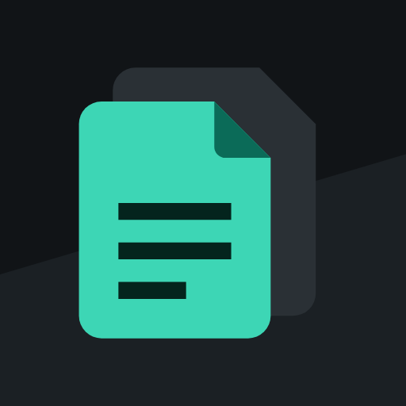
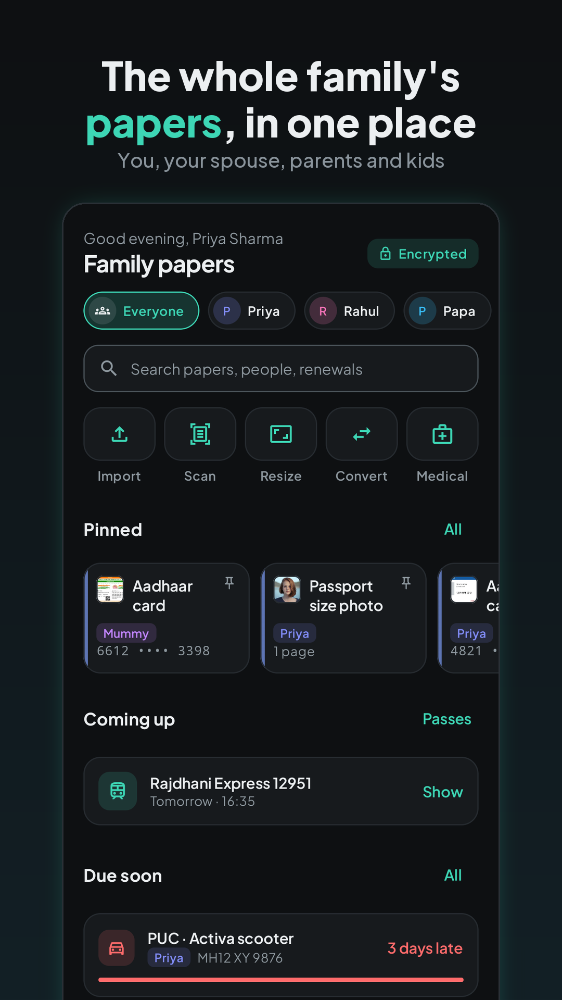
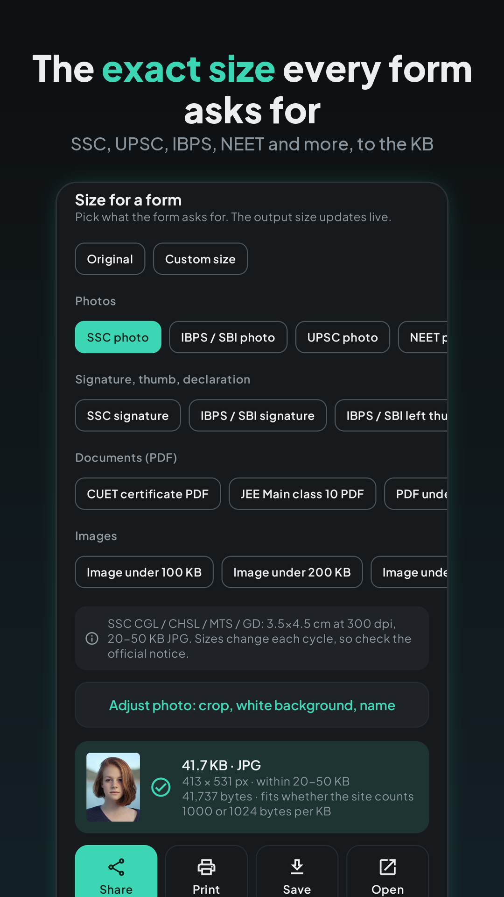
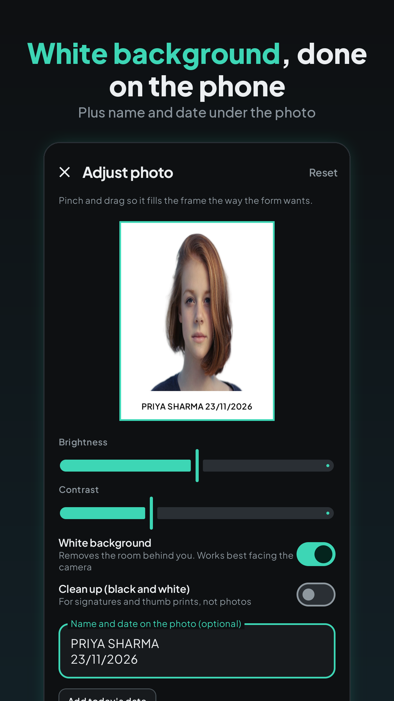
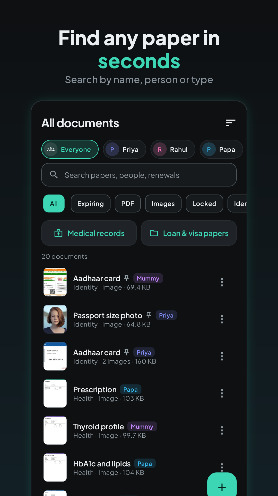
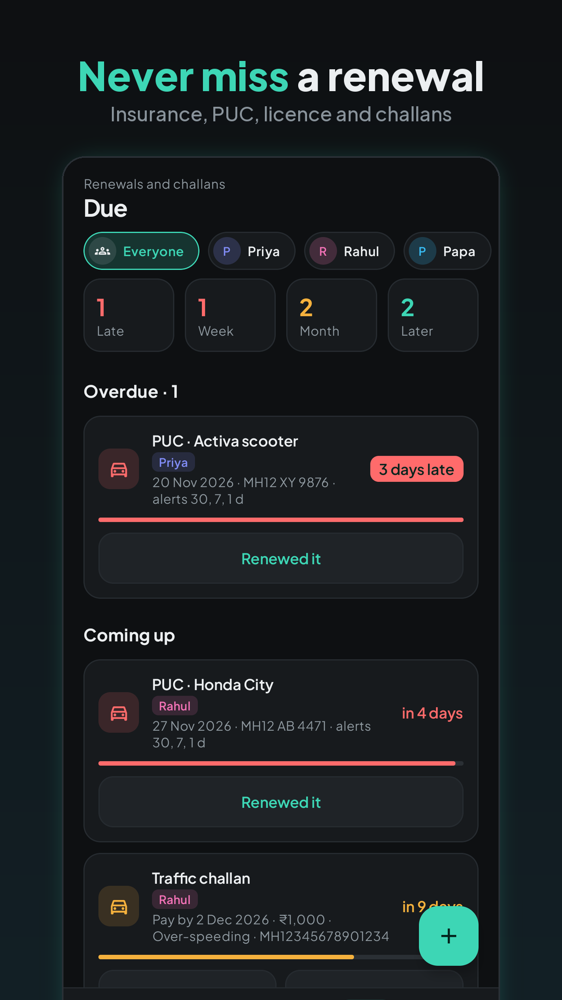
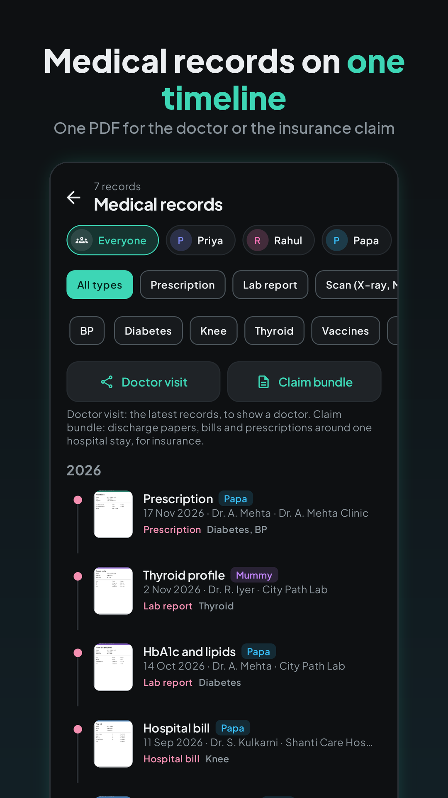
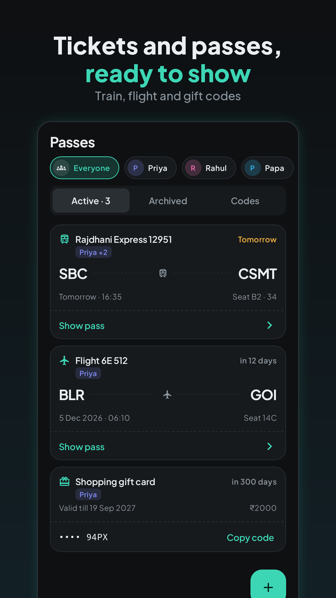
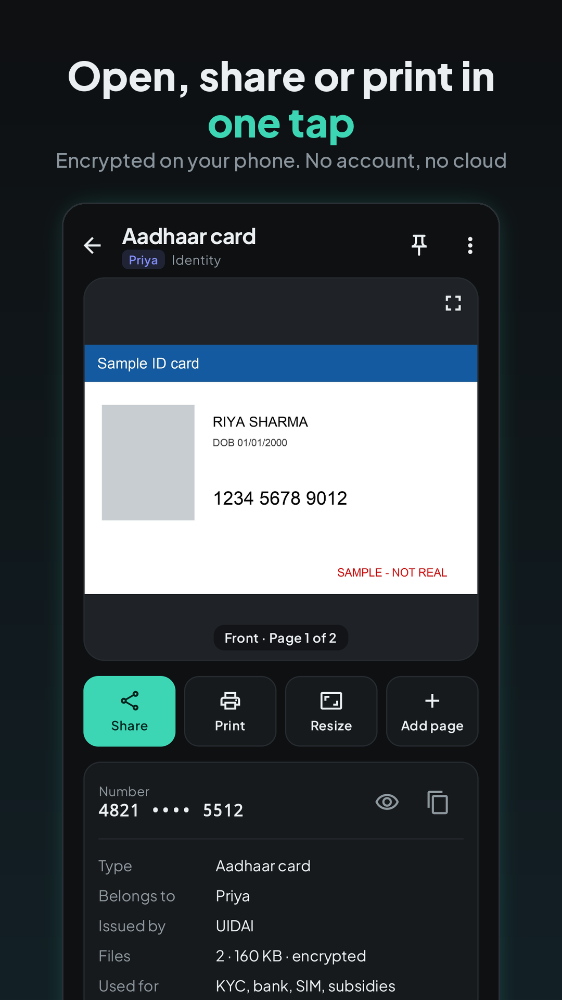

# Mere Kaagzaat

### All your family's papers, in one place

Aadhaar, PAN, marksheets, the car's RC and PUC, Papa's prescriptions, salary slips for the loan. Mere Kaagzaat keeps every paper for every person in the family on your phone, sorted, so you can find any of them in seconds and send it at the exact size a form asks for. No account, and everything stays on your phone.

&nbsp;
&nbsp;
&nbsp;

&nbsp;
&nbsp;
&nbsp;

---

## What it does

**One place for the whole family**
- Up to 10 people: you, your spouse, parents, children, anyone you look after
- Every paper is tagged with whose it is, so two Aadhaar cards never get mixed up
- Papers that belong to more than one person, like a family health floater or a shared ticket, show for each of them
- 290+ Indian document types built in, plus your own types and categories

**Find and share in seconds**
- Search that understands how people type: "aadhar", "matric", "papa", "insurance"
- Share on WhatsApp or e-mail, print, or save a copy
- Card front and back on one A4 sheet, like a photocopy
- Reads the card for you: number, issue and expiry dates fill themselves in

**The right size for every form**
- Presets for SSC, UPSC, IBPS, SBI, NEET, CUET, JEE Main, GATE, RRB, state PSCs, PAN and more
- Photo, signature, thumb and declaration at the exact pixels, centimetres and KB the form asks for
- Fits both ways portals count a KB, and shows the exact bytes
- White background for photos, done on the phone; signatures cleaned up to crisp ink; name and date under the photo
- PDF to images, images to PDF, compress a PDF, remove a PDF's password

**Never miss a renewal**
- Car and bike insurance, PUC, health insurance, licence, passport, property tax and more
- Reminders before the due date; overdue items clearly marked
- Traffic challans with a link to pay on the official Parivahan site
- "Renewed it" moves the date to the next cycle

**Medical records, loan papers and passes**
- Prescriptions, lab reports, scans, bills and discharge papers on one timeline per person
- One PDF for a doctor visit or an insurance claim, with a summary page on top
- Salary slips, bank statements and ITR month by month; the last 3 or 6 months in one PDF
- Train and flight tickets, a clear code to show at the gate, gift card and voucher codes

**Private by design**
- No account, no cloud, no sign-up. Works offline
- Documents encrypted on the phone (AES-256)
- Optional 4-digit PIN for the whole app or only for the papers you lock; fingerprint unlock
- Screenshots of your papers are blocked
- Password-protected backup files that you keep, plus an optional weekly backup to a folder you choose

## Get it

Coming soon on Google Play.

## Privacy

Read the [privacy policy](PRIVACY.md). In short: your papers stay on your phone and are never uploaded. The app goes online only for the ad banner.

## Support

Questions, bugs or ideas: rishabhdahiya.work@gmail.com, or [open an issue](https://github.com/S0ul-Sh3ll/MereKaagzaat-Public/issues).

Mere Kaagzaat is an independent app, not affiliated with UIDAI, the Income Tax Department, DigiLocker, Parivahan or any government body. The people, numbers and documents in the screenshots are made up for the demo.
